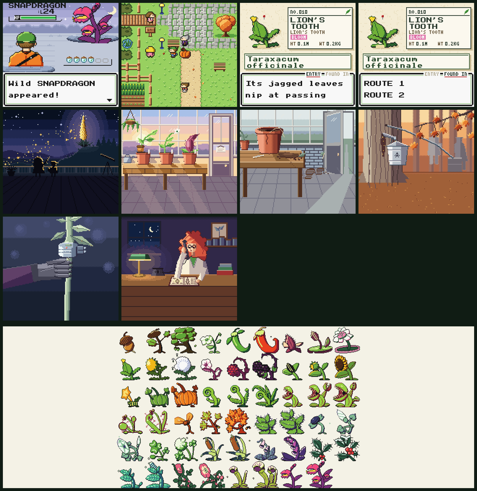

# Verdant Reach

**[▶ Play in your browser](https://minormending.github.io/verdant-reach/)**: keyboard, game controller, or touch on phones and tablets.

**[Guidebook](https://minormending.github.io/verdant-reach/guide.html)**: the official strategy guide, with a walkthrough, every map, wild plant, item and trainer, and the full Field Herbarium, generated from the game's own data ([docs/GUIDE.md](docs/GUIDE.md)).



A Game Boy Color–style monster collector in which every creature is a real
plant. You're a junior botanist. The night a once-a-century flower blooms,
certain plants across the valley wake up, and your job is to catalogue the
QUICKENED. Then you find out who woke them, and why.

The **whole game is complete**: the Prologue through Chapter 11 (the Council),
the Hall of Fame and credits, and a post-game of legendaries, a hidden dungeon and Council rematches. The chapters run
straight on, one into the next, and after the credits the town, the Herbarium and the Council have new things to say.
The story bible lives in [docs/story/](docs/story/).

## Play

```bash
npm install
npm run dev
```

Then open http://localhost:5173. For a production build, run `npm run build`
and serve `dist/` with any static server.

| Button | Keys | Controller |
|---|---|---|
| Move | Arrows / WASD (hold **B** to run) | D-pad (or left stick) |
| A | Z, Space, J | A: the right face button |
| B | X, Esc, Backspace, K | B: the bottom face button |
| START (menu) | Enter | START / + |
| SELECT | Shift | SELECT / − |

**Game controllers** work through the browser's Gamepad API: press a button on
the controller once the page is open. Buttons follow the Game Boy's layout by
position (A right, B bottom), so Nintendo-layout pads such as the 8BitDo Zero 2
(in any of its modes) and the Switch Pro Controller match their labels; on an
Xbox-layout pad, A is the button marked B. Browsers don't let a controller
start sound, so press a key or click once if the game is silent.

On phones and tablets, an on-screen D-pad and buttons appear automatically.
Press **F** (or the corner button) for fullscreen. Time of day follows your
real clock: morning 4–10, day 10–18, night 18–4. Some plants only appear at
night. Add `?time=morning|day|night` to the URL to override it.

## What's in the slice

- **85 hand-composed maps.**
  - Fallowfield's farms and windmill, Hedgerow's lanes, brick-and-bramble Bramblegate, and autumnal Sugarbush.
  - The Night Meadow, and the Sugarbush Grove dungeon.
  - **Glasshouse City** under its vast glass dome: the Root Relay, the Nursery Garden, the tropical Palm House, the big market, and the Route 4 orchard on the way in.
  - **Chapter 5:** Route 6's misty old-growth canopy walkway, Cedarhallow (a town among living cedars), the fire-scarred Burnt Stand and the Hollow shrine inside the oldest cedar.
  - **Chapter 6:** the salt-marsh estuary of Route 7, the port of Saltmarsh Harbour with its sick Lantern Tree on the point, the open sea of Route 8, and volcanic Driftseed Isle with its optional Vents cave.
  - **Chapter 7:** Route 9's climb through larch forest and scree into snow, the alpine lake town of Larchmere and its Lakeside Lodge, Bloom Lake (forced awake and turned red until you calm it), and the Rootstock hideout hidden beneath the lodge.
  - **Chapter 8:** Rootstock has seized Glasshouse City's Root Relay and is broadcasting a command that freezes every Quickened plant. Climb its floors (the server hall, the patch bay and its console puzzle, and the roof's listening mast) to stop it.
  - **Chapter 9:** Route 10's dry scrub country, the desert-edge town of Thistledown in tumbleweed country, Route 11's red canyon switchbacks, and Sanguine Ridge, crowned by ancient dragon's blood trees.
  - **Chapter 10:** Route 12, a broken plateau of gorges that tests every field move (the game's Victory Road); the Council Arboretum before the sealed Grove Gate; the three rings of the Elder Grove, a forest that is one creature, whose lanes shift as it listens; and its heart.
  - **Chapter 11:** the Council of the Arboretum, five seats taken in one run: BELLADONNA's poison-garden apothecary, MIMI OSA's moonlit sleep garden, TITUS ARUM's steaming rot house, PYRA's brazier hall, and the Keeper's Hall of ROWAN VALE. Win all five and the story ends in the Herbarium.
  - **The post-game:** the Seed Vault, a frozen seed bank under the northern peaks reached by a new spur off Route 9 (dark ice corridors, a root-broken storage hall and the Frozen Archive), and Methuselah Ridge, a bare summit above the clouds where the oldest bristlecone wakes only at night.
  - Eight Conservatory puzzles: Hollis's lever-gated hedge maze, Nell's bog valves, Flora's rose-trellis maze, Morrow's dark Conservatory (the safe path shows only in the lantern's light), Brother Saguaro's boulder puzzle, Captain Reyes's raft-and-lever pools, Signe's ice-slide floor and Valerian Rook's boulder pits, where pushed boulders fill the pits to make a path.
- **134 trainers.** Leaders HOLLIS (Wood), NELL PITCHER (Bug), FLORA VANCE (Bloom, the difficulty spike), MORROW (Ghost), BROTHER SAGUARO (Thorn), CAPTAIN REYES (Water), SIGNE (Frost) and VALERIAN ROOK (Dragon, the hardest), Rootstock's admins DR. CALLOWAY and WREN, rematches with SHEARS, CALLOWAY and WREN in the Grove, MERCER THORNE himself at the heart, the Council (BELLADONNA, MIMI OSA, TITUS ARUM, PYRA and the Keeper, ROWAN VALE) and their +8 post-game rematches, rival BRAM ×5 (the fourth time with a graft-collared partner, the fifth a friendly rematch), and ROOTSTOCK grunts with their admin SHEARS. Staged cutscenes use camera pans, flashes and ambience.
- **130 species (including THE ELDER at the Grove's heart; the three roaming Wanderers TUMBLEWEED, COCONUT and BURR; the mythical METHUSELAH; and the CENTURYHEART, a gift that takes a century to flower), 120 moves and 9 types.** Every species is a real plant that grows through its real life stages, poses as a creature in battle and has an idle animation. Every Herbarium entry contains a fact-checked true fact and shows where the species is FOUND.
- **Systems:**
  - Crystal-style battles with a modern feel: the physical/special split, statuses, weather, critical captures, SUPER/WEAK hints, and 40 move-animation families.
  - Catching with nicknames, and growth (evolution) by level, by time of day and by friendship.
  - **The Nursery Garden:** board two plants that share a pollination group and they set a SEED, which sprouts in your party as you walk.
  - **Field moves:** PRUNE clears brambles, opening shortcuts and hidden stashes across the old routes. RAFT rides a giant lily pad across water, UPROOT pushes boulders with a Quickened's roots, and ROOT BRIDGE grows a living fig root across narrow gorges.
  - **Item growth:** EMBER ASH opens a sealed lodgepole cone, the way real fire-cones need fire to release their seed, and a COLD SNAP wakes a snowdrop bulb that needs a winter before it grows. The FOXFIRE LANTERN lights dark maps.
  - **The CRIMSON LILY:** a one-off crimson giant water lily waiting on Bloom Lake's islet. Catch it or lose it for good.
  - Party (with move reordering), bag, a pressed-specimen Field Herbarium, storage cabinet, shop and options.
  - Saving, whiteout, real-time day and night with lamp-lit nights, and ambient particles (pollen, leaves, fireflies, mist).
  - **Side content:** fifteen side quests tracked in a NOTES log, a market trade (swap a vanilla vine for the trader's POLLY, which blooms into a vanilla orchid on arrival), 39 hidden items, and berry and rose-hip bushes that regrow each real day.
  - **Your lead Quickened follows you** around the overworld (toggle in OPTIONS).
  - **Eighteen illustrated stills** at key story moments.
  - **Roaming legendaries:** TUMBLEWEED roams the dry routes and COCONUT the sea, fleeing after one turn with their damage kept between meetings; BURR hitches a ride, popping up on the tile behind you.
- **An original chiptune soundtrack:** 41 tracks, jingles, sound effects, a cry per species, and ambient wind, bird and cricket beds, all synthesised live with WebAudio.
- **Art:** all hand-built pixel art, stored as swappable bundles in `public/art/` (a folder of PNGs plus JSON per creature, tileset, structure and character; format in [docs/ART.md](docs/ART.md)). Every species follows the Crystal rule (shared black outline and white highlights, two species tones, a per-species entrance animation; [docs/CREATURES.md](docs/CREATURES.md)). Art packs override any subset: try `?art=classic` for the pre-Crystal sprites or `?art=traced` for the original photo-traced ones.
  - 130 species with idle animations, true back views and a real-cultivar shiny ("sport") palette each ([docs/SPORTS.md](docs/SPORTS.md)), to the creature design guide in `docs/CREATURES.md`.
  - Autotiled environments with ground variation.
  - Unique characters with weighted walk cycles, and trainer portraits.
  - Title art.
  - Species were drawn from real-plant photo references; the photo credits are in `public/art/CREDITS.md`.
- **Editable game data:** every species' stats, types, learnset, growth, catch rate and Herbarium page (with its fact's source) is plain JSON, one file per evolution line in `src/data/species/`; moves and items are in `src/data/moves.json` and `src/data/items.json` (format in [docs/DATA.md](docs/DATA.md)). Edit a number and the game, the data tests and the balance tests pick it up; art stays separate, so swapping an art pack never changes gameplay.

## Development

| | |
|---|---|
| `npm run typecheck` | strict TypeScript |
| `npm test` | vitest: 1562 tests, including world validation, puzzle solvability, trainer-blocking and a boss-balance simulation |
| `?dev=<module>` | isolated dev scenes: `battle`, `screens`, `audio` (jukebox), `ui`, `overworld`, `world`, and `art` (the **Art Lab**: browse and live-swap every art bundle) |
| `?dev=world&play=1&map=<id>&flags=a,b&species=<id>&level=<n>` | drop into any story state |
| `npm run e2e` | headless full playthrough (216 beats through the ending and the whole post-game, about 38 minutes; first use: `npx playwright install chromium`). CI runs it before every deploy. |

The art lives in `public/art/` and the game reads it directly: edit a PNG,
reload, and it's in the game. The Python tools in `tools/art/` (Pillow +
NumPy; any Python 3.12+ environment with `pillow` and `numpy` will do) work on
those bundles:
- `python tools/art/art.py …` lists, validates, previews, explodes and repacks
  tilesets, swaps sprites and edits palettes;
- `python tools/art/build_all.py` validates and rebuilds `public/art/index.json`;
- `--regen` re-runs the generators, which reproduce every generated bundle
  byte-for-byte and never touch hand-edited ones.

See docs/ART.md §11.

Architecture, ownership and conventions: [docs/ARCHITECTURE.md](docs/ARCHITECTURE.md).
Slice scope: [docs/SLICE.md](docs/SLICE.md).
Contracts shared by all modules: `src/contracts/`.

## Known limitations

- **The audio was mixed by measurement only.** Levels were set with offline renders; a human listening pass is still worthwhile.
- **Balance comes from simulation and automated play** (`src/battle/logic/balance.test.ts`, `e2e/`). Human play-testing should still tune feel.
- **Scope:** the story bible is fully built. A modern restyle (a wider 320×180 screen with new art) is in progress on the `restyle` branch.
